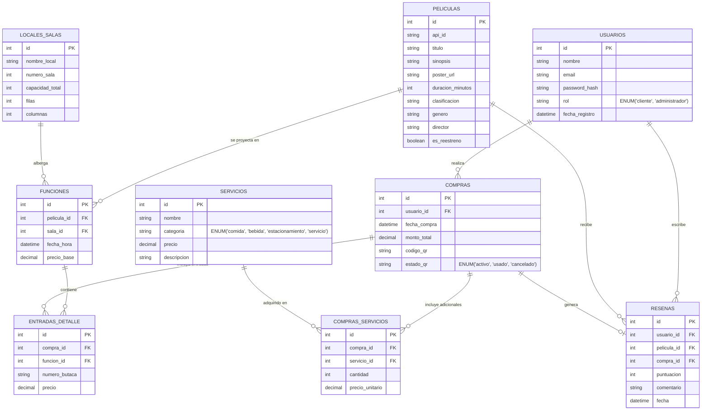

# IDS-ProyectoIntegrador-FIDS

# Hito 1: Propuesta y Análisis Fundamental - Proyecto Integrador "Cine Paradiso"

**Materia:** Introducción al Desarrollo de Software (IDS 2026)  
**Fecha de Entrega:** 26/10/2026  
**Proyecto:** Cine Paradiso - Plataforma Web de Venta de Entradas y Gestión Cinematográfica  

---

## 1. Hipótesis de Trabajo, Supuestos, Reglas de Negocio y Alcance

### 1.1. Contexto del Negocio
**Cine Paradiso** es una empresa de entretenimiento que cuenta con **3 sedes/locales** comerciales, cada una equipada con salas de proyección de capacidades variables. La propuesta de valor diferencial del negocio reside en proyectar películas de reestreno y clásicos del cine.

El sistema a desarrollar constará de dos plataformas integradas:
1. **Portal Web para Clientes:** Visualización de cartelera, selección gráfica de butacas, compra de entradas, contratación de servicios adicionales (pochoclos, bebidas, estacionamiento, pase VIP), gestión de reservas/cancelaciones y generación de código QR de acceso.
2. **Backoffice de Administración:** Gestión de sedes, salas, películas y funciones, administración de servicios adicionales, escaneo/validación de códigos QR en puerta y dashboards estadísticos de ocupación y ventas.

### 1.2. Conceptos Clave del Dominio
* **Sede / Local:** Complejo físico donde se encuentran las salas de cine.
* **Sala:** Espacio físico dentro de una sede con una capacidad y distribución específica de filas y columnas de butacas.
* **Película:** Obra cinematográfica catalogada en el sistema.
* **Función:** Proyección puntual de una película en una sala y sede específica, en una fecha y hora determinadas (`DATETIME`).
* **Butaca:** Asiento individual identificado por fila y columna dentro de una sala.
* **Compra / Reserva:** Transacción realizada por un cliente para una función específica, que incluye entradas (butacas seleccionadas) y opcionalmente servicios adicionales.
* **Código QR:** Identificador único codificado generado por el sistema tras la compra, utilizado como ticket digital de ingreso.

### 1.3. Reglas de Negocio y Restricciones Técnicas
1. **Estructura de Roles:** Existirán dos roles de usuario en el sistema: `cliente` y `admin`.
2. **Integridad de Selección de Butacas:** Una misma butaca no puede venderse dos veces para la misma función. El sistema debe garantizar la disponibilidad en tiempo real.
3. **Política de Cancelación:** Los clientes pueden cancelar sus compras únicamente hasta un límite de tiempo previo al inicio de la función (ej. 2 horas antes).
4. **Manejo de Fechas y Horarios:** Todos los horarios de funciones y fechas de compras deben registrarse obligatoriamente en columnas de tipo `DATETIME` (prohibido utilizar columnas separadas para fecha y hora).
5. **Consumo de API Externa:** Los datos complementarios de las películas (sinopsis, pósters, afiches) se podrán obtener mediante integración con una API pública gratuita (OMDb API o TMDb API).
6. **Prohibición Estricta de ORMs:** No se permite el uso de SQLAlchemy, SQLModel ni ningún otro ORM o mapeador objeto-relacional. Todas las interacciones con la base de datos se realizarán mediante **consultas SQL explícitas y puras** utilizando conectores como `mysql-connector-python`.
7. **Prohibición de Asincronismo en el Navegador (`fetch` / `axios`):** Está prohibido realizar peticiones HTTP asincrónicas desde JavaScript en el navegador hacia el Backend. La comunicación entre el Frontend en Flask y el Backend REST API se realizará exclusivamente en el servidor mediante la librería `requests` de Python.
8. **Generación y Escaneo de QR:** Cada compra generará un código QR único que será escaneado por el personal de recepción desde el Backoffice para validar el ingreso y cambiar el estado del ticket a `usada`.

### 1.4 Estructura del proyecto

cine-paradiso/
├── app.py                        # Entry point único de Flask (Puerto 5000)
├── requirements.txt              # Dependencias (Flask, mysql-connector-python, etc.)
├── .env                          # Variables de entorno (DB_HOST, DB_USER, SECRET_KEY)
├── database/                          # Paquete principal de la aplicación
|   ├── docker-compose.yml
│   └── schema.sql                    # Script DDL de la base de datos
|
├── web/                          # Paquete principal de la aplicación
│   ├── config/
│   │   └── db.py                 # Conexión a MySQL (mysql-connector-python)
│   │
│   ├── routes/                   # Capa 1: Controladores / Endpoints / Vistas
│   │   ├── site/                 # FALTA COMPLETAR TODO ROUTES
│   │   │   └── home.py
│   │   │   └── peliculas.py
│   │   └── admin/                
│   │       └── peliculas.py
│   │
│   ├── validators/               # Capa 2: Validaciones de entrada (JSON / Formularios)
│   │   ├── validatorsPeliculas.py
│   │   └── validatorsCompras.py
│   │
│   ├── services/                 # Capa 3: Lógica de negocio (reglas, cálculo de montos, QR)
│   │   ├── servicePeliculas.py
│   │   └── serviceCompras.py
│   │
│   ├── repositories/             # Capa 4: Acceso a datos (Consultas SQL puras a MySQL)
│   │   ├── repositoryPeliculas.py
│   │   └── repositoryCompras.py
│   │
├── templates/                # Plantillas Jinja2
│   ├── base.html
│   ├── 500.html
│   ├── 404.html
│   ├── site/
│   │    ├── inicio.html
│   │    └── cartelera.html
│   └── admin/
|  
└── static/                   # Recursos estáticos
    ├── css/
    │    └── estilos.css
    └── js/
    │    └── main.js

---

## 2. Backlog de Producto (Épicas e Historias de Usuario)

El backlog del proyecto se organiza en 5 épicas principales, descomponiéndose en Historias de Usuario (HU) listas para su incorporación en el tablero Kanban de GitHub Projects.

### Épica 1: Autenticación, Usuarios y Perfiles
* **HU01: Registro de Clientes**
  * *Como* cliente, *quiero* crear una cuenta ingresando mi nombre, email y contraseña, *para* poder acceder al sistema de compras y guardar mi historial.
* **HU02: Inicio de Sesión y Autenticación**
  * *Como* usuario (cliente o admin), *quiero* iniciar sesión con mis credenciales, *para* obtener un acceso seguro según mi rol.
* **HU03: Perfil de Usuario e Historial**
  * *Como* cliente, *quiero* ver mis datos personales y consultar el historial de mis compras pasadas y reservas vigentes.

### Épica 2: Cartelera, Películas y Selección de Butacas
* **HU04: Consulta de Cartelera y Detalles de Películas**
  * *Como* cliente, *quiero* explorar la lista de películas disponibles por sede y fecha, viendo sinopsis, duración, clasificación y pósters obtenidos de la API externa.
* **HU05: Mapa Interactivo de Butacas por Función**
  * *Como* cliente, *quiero* visualizar el mapa de la sala para una función seleccionada, identificando claramente las butacas disponibles y ocupadas.

### Épica 3: Proceso de Compra, Servicios Adicionales y Cancelaciones
* **HU06: Selección de Servicios Adicionales**
  * *Como* cliente, *quiero* agregar combos de pochoclos, bebidas, estacionamiento o pases VIP a mi compra antes del checkout.
* **HU07: Checkout, Confirmación y Generación de QR**
  * *Como* cliente, *quiero* confirmar el pago de mi reserva y recibir un resumen detallado con su correspondiente código QR de acceso.
* **HU08: Cancelación de Reservas**
  * *Como* cliente, *quiero* solicitar la cancelación de una compra vigente siempre que me encuentre dentro del plazo permitido previo a la función.

### Épica 4: Backoffice y Administración General
* **HU09: Gestión de Sedes, Salas y Funciones**
  * *Como* administrador, *quiero* dar de alta, modificar y listar sedes, salas y programar funciones asignando películas y horarios.
* **HU10: Administración de Catálogo de Servicios Adicionales**
  * *Como* administrador, *quiero* definir los productos y servicios adicionales disponibles en las salas con sus respectivos precios.
* **HU11: Dashboard Estadístico de Ventas e Ocupación**
  * *Como* administrador, *quiero* consultar reportes visuales de porcentaje de ocupación por sala, películas más vistas y recaudación por franja horaria.

### Épica 5: Control de Ingreso a la Sala
* **HU12: Escaneo y Validación de Códigos QR**
  * *Como* administrador/recepcionista, *quiero* escanear el código QR presentado por el cliente en la entrada *para* verificar la validez de la entrada y marcarla como utilizada.

---

## 3. Esquema de Base de Datos Relacional (DDL SQL - MySQL)



---

## 4. Especificación de Endpoints API RESTful (Backend Flask)

La API REST opera bajo el formato estándar **JSON** para la recepción y envío de datos, gestionando los códigos de respuesta HTTP adecuados.

| Módulo | Verbo HTTP | Endpoint | Descripción | Body / Query Params | Respuestas HTTP |
| :--- | :--- | :--- | :--- | :--- | :--- |
| **Auth** | `POST` | `/api/auth/register` | Registrar un nuevo usuario cliente. | `{nombre, email, password}` | `201 Created`, `400 Bad Request` |
| **Auth** | `POST` | `/api/auth/login` | Autenticar usuario y obtener credenciales/token. | `{email, password}` | `200 OK`, `401 Unauthorized` |
| **Películas** | `GET` | `/api/peliculas` | Listar cartelera completa de películas. | `?sede_id=1&fecha=2026-10-30` | `200 OK`, `500 Internal Error` |
| **Películas** | `GET` | `/api/peliculas/<id>` | Obtener detalle e información de una película. | - | `200 OK`, `404 Not Found` |
| **Funciones** | `GET` | `/api/funciones` | Listar funciones disponibles según filtros. | `?pelicula_id=3&local_id=1` | `200 OK` |
| **Funciones** | `GET` | `/api/funciones/<id>/butacas` | Consultar mapa de butacas libres y ocupadas. | - | `200 OK`, `404 Not Found` |
| **Servicios** | `GET` | `/api/servicios` | Listar productos y servicios adicionales disponibles. | - | `200 OK` |
| **Compras** | `POST` | `/api/compras` | Registrar una nueva compra/reserva con entradas y servicios. | `{id_usuario, id_funcion, butacas: [1,2], servicios: [{id:1, cant:2}]}` | `201 Created`, `400 Bad Request` |
| **Compras** | `GET` | `/api/compras/usuario/<id>` | Consultar historial de compras de un usuario. | - | `200 OK`, `404 Not Found` |
| **Compras** | `PATCH` | `/api/compras/<id>/cancelar` | Solicitar la cancelación de una reserva activa. | - | `200 OK`, `400 Bad Request`, `404 Not Found` |
| **Admin** | `POST` | `/api/admin/peliculas` | Backoffice: Alta de película manual o vía OMDb. | `{titulo, sinopsis, duracion, poster_url}` | `201 Created`, `400 Bad Request` |
| **Admin** | `POST` | `/api/admin/funciones` | Backoffice: Programar nueva función en sala/local. | `{id_pelicula, id_sala, fecha_hora, precio}` | `201 Created`, `400 Bad Request` |
| **Admin** | `POST` | `/api/admin/validar-qr` | Escanear y validar ticket QR en el acceso a la sala. | `{codigo_qr}` | `200 OK`, `400 Bad Request`, `404 Not Found` |
| **Admin** | `GET` | `/api/admin/dashboard` | Obtener métricas de ocupación y facturación. | `?desde=2026-10-01&hasta=2026-10-31` | `200 OK` |

---

## 5. Repositorio GitHub y Tablero Kanban en GitHub Projects

### 5.1. Estrategia de Ramas (GitHub Flow)
* **`main`**: Rama de producción estable. Todo código integrado en esta rama debe ser funcional y estar libre de errores.
* **`develop`**: Rama principal de integración para el equipo de desarrollo.
* **`feature/<nombre-funcionalidad>`**: Ramas de trabajo individuales (ej. `feature/login-backend`, `feature/mapa-butacas`). Cada integrante del grupo desarrollará su tarea en una rama aislada e integrará sus cambios a `develop` únicamente mediante **Pull Requests (PR)** revisados.

### 5.2. Tablero Kanban en GitHub Projects
El proyecto integrador utilizará un tablero Kanban estructurado en las siguientes 5 columnas:
1. **Backlog:** Historias de usuario y tareas pendientes de priorizar.
2. **Ready (Listas para iniciar):** Tareas refinadas con criterios de aceptación claros asignadas a integrantes.
3. **In Progress:** Tareas actualmente en desarrollo por los integrantes del grupo.
4. **In Review:** Pull Requests abiertos que están siendo revisados por los compañeros de equipo antes de mergear.
5. **Done:** Funcionalidades testeadas e integradas exitosamente en la rama de integración.

### 5.3. Convención de Mensajes de Commit
Se adoptará la convención de *Conventional Commits* vinculada a los *Issues* de GitHub Projects:
* `feat(auth): agrega endpoint POST /api/auth/register #1`
* `fix(db): corrige foreign key en tabla funciones #5`
* `docs(readme): actualiza instrucciones de ejecucion en init.sh #12`

## Configuracion
```bash
cp .env.base .env            # los defaults ya funcionan en local

python -m venv .venv
.venv\Scripts\activate          # Windows
# source .venv/bin/activate     # Linux/macOS
pip install -r requirements.txt

python app.py                   # http://localhost:5001
```
